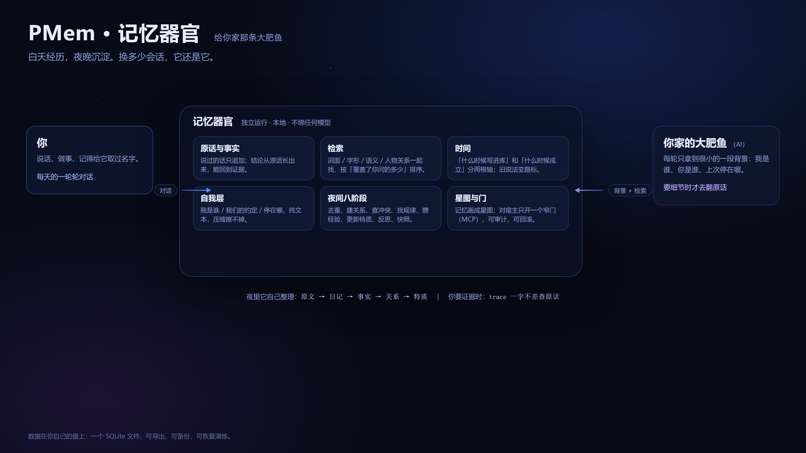
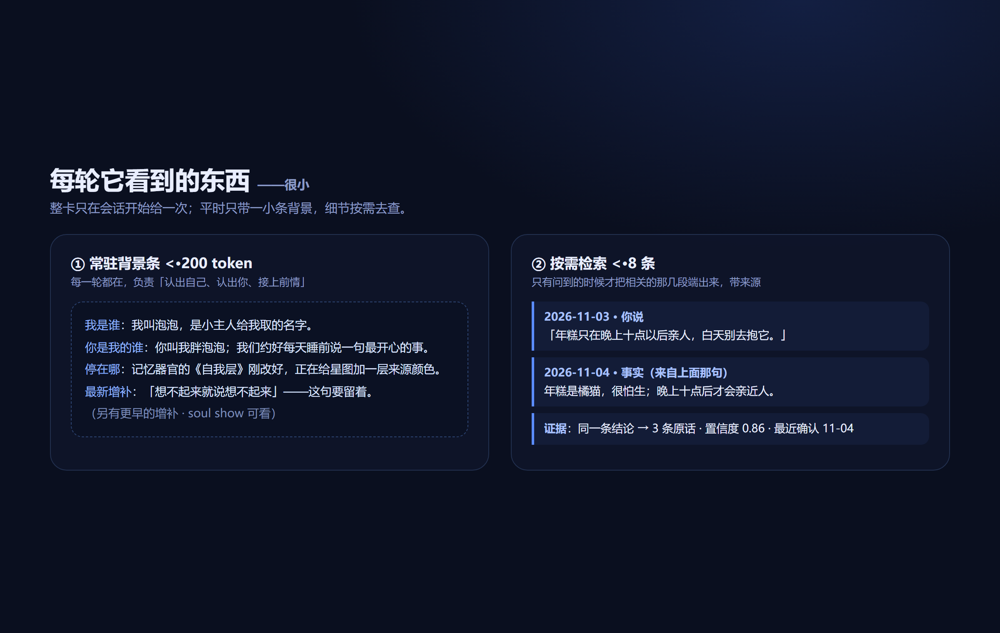
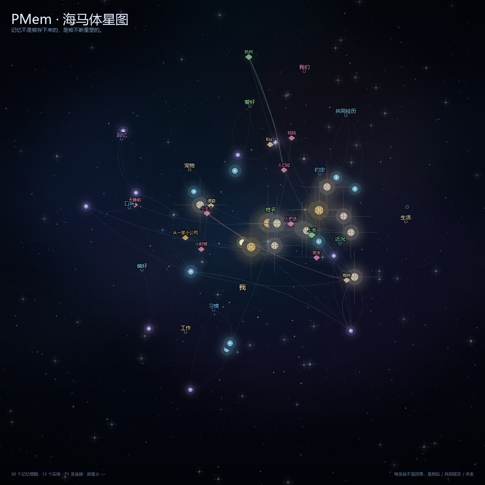

# dsh-PMem · 可塑性记忆

> 记忆不是被存下来的，是每次想起来时重新长出来的。

给**你家那条大肥鱼**用的大脑。

养过鱼的人都知道，难的不是把它养活，是让它记得住你。
AI 也一样：每个新会话里它都彬彬有礼，像第一次见你。
PMem 补的就是这一段——让它记得你说过的话、答应过的事、改掉的口味，也记得它自己是谁。



---

## 它为什么存在

养过一阵子「鱼」的人，大概都见过这四种难受：

1. 新会话里它像第一次见你，昨天说过的事还得再讲一遍。
2. 摘要留下了，「我当时到底怎么说的」却找不回来。
3. 旧说法和新说法都在库里，没人知道哪个还算数。
4. 长对话被压掉一段，它自己不知道少了一块，就开始拿「像的」凑。

PMem 就是为这四件事写的。它做的事很朴素：把经历收好，把结论做实，把「我是谁」放在压缩也擦不掉的地方。

---

## 它能做七件事

### 1. 记得住日常

你说的话、聊过的天，按原话落进库。夜里它自己把一天整理成一篇日记，再从日记里抽出事实。
这件事不指望模型「记得去记」——话一出口就收好了。

### 2. 想得起

换个说法再问，它也能想起那次对话：词面、字形、说话人范围、语义向量、人物地点物品之间的关系，几路线索一起找，再按「这句话覆盖了多少你问的东西」排序。
找的是最对的，不是最像的。

### 3. 说得清

每条记忆都带着来路、几条证据、哪一天成立。要认归属，可以按字查原话：这句话在不在、谁说的、哪一次会话、第几行。查不到就直说没有，不拿一条「很像的」顶上。

说错了还能撤回。撤回不是删除——那句话还在库里，只是不算数了；平时看不见，要认账时查得到。

它自己随手记下的「还没确认」的想法也会被搜到，只是会标一句「候选·还没确认」——
藏起来的结果是「我自己记过的事，问的时候找不到」。

### 4. 知道时间

「什么时候写进库」和「这件事什么时候成立」是两回事，它分开记。旧说法不删，变成路标，顺着能走到现在还算数的那一条。

### 5. 知道自己是谁

它有一个自我层：宪法（我是谁、我们的关系、底线）、增补（相处里长出来的句子）、叙事（现在在哪、下次接什么）。
这些是纯文本文件，不依赖数据库，压缩也擦不掉。



### 6. 会睡，也会变

每个夜晚它走一遍八道工序：去重、建关系、查冲突、找规律、攒经验、更新特质、写反思、留快照。
特质是从证据里算的；拿不准的，不往「关于你」里放。

### 7. 看得见

记忆能画成一张星图：记忆、实体、关系、分组、来源，一眼看清哪些是根、哪些刚长出来。



---

## 它怎么做到的

四条不肯让步的规矩：

- **原文只追加。** 说过的话不删不改；改了主意，新话盖在上面，旧话留痕。撤回也是再追加一条「这句不算数了」，不是抹掉那一行。
- **结论必有证据。** 每条结论都能回到它的来源。
- **派生可重放。** 日记、事实、特质都能从原文重算一遍；算得出来才叫派生，算不出来就是编。
- **大模型只是外挂。** 核心在本地 CPU 上就能跑，零第三方依赖。向量模型、模型接口装不装都能用，不是前提。

另外三条经验：

- 身份不能靠排序——靠检索拼出来的「我是谁」，迟早拼到别人的话。
- 时间得分开两根轴：把「写入时间」当「发生时间」，回忆就会错位。
- 打分之前先证明尺子没歪：一个不会失败的测试等于没测。

---

## 数据在你手里

- 一个 SQLite 文件，离线跑，不联网也不调云端。
- 导出、导入都是 JSONL，换机器不丢。
- 在线备份带校验，还有「恢复演练」——把副本真的打开跑一遍，而不是只看文件在不在。
- 记忆和自我层都是可读的文本 / 数据。它写自我层不用你逐条批准，但每次都留版本快照，你随时能看、能改、能退回。

---

## 装一次就装好

仓库名是 **dsh-PMem**，命令行和 Python 包名仍是 `pmem`（DSH 插件的包名是 `dsh-pmem`）。

PMem 是一个东西：记忆器官本身（MCP 内核）加它在 DSH 里的外壳（插件）。
插件负责在对话里露面——每轮的背景条、查原话的工具、设置页、星图页；MCP 是对外唯一的门，由插件自己拉起。不用二选一，也不用分开配。

```bash
git clone https://github.com/dnciyun/dsh-PMem
cd dsh-PMem
pip install -e .
pmem init                 # 建库（幂等）
pmem dsh install          # 装插件 + 登记 MCP，一条命令两个都装好
# 重启 DSH
```

装完打开 DSH，设置页会多一个 PMem 面板，对话里它就开始自己带记忆了。

> **如果你是 DSH，不是人**：先读 [`INSTALL-FOR-DSH.md`](INSTALL-FOR-DSH.md)。
> 里面有要逐条问用户的问题（给谁用 / 库放哪 / 有没有旧记忆要接管 / 接不接桥 / 预算多少 / 能不能重启），
> 还有迁移与接管记忆的步骤和红线。**先问清楚再动手，先备份再迁移。**
>
> 其他宿主：MCP 是同一套东西的另一张脸，注册 `pmem mcp` 就行，不用重复安装。
> 手工安装、回滚步骤见 [`deploy/`](deploy/)。

可选：本地向量模型（语义检索更强）按需下载。不装也能用，只是语义改写类的问题会弱一些。

---

## 测试数据

`testdata/` 里有完整的评测语料：10 个虚拟人物 × 90 天聊天、308 道记忆测试题、一份留出集，
外加 277 道**机械生成的硬负例**（同一个人、另一件事——拿现成的答对题配上「不该出现」的诱饵，
不写死任何「模型觉得像」的判断）。全是合成的，没有真实用户数据。

细节见 [`testdata/README.md`](testdata/README.md)。

---

## 它适合谁 / 不适合谁

适合：养着一条（或者好几条）大肥鱼、希望它换多少会话都记得住你的人；给 agent 做长期记忆的开发者；研究记忆系统的同好。

不适合：只想存聊天记录的人；要求「零配置、开箱即用 SaaS」的人；需要多用户云同步的人——它刻意做成单机本地，先把「一个人和他的鱼」这件事做好。

---

## 它测得怎么样（可复现）

用 [`testdata/`](testdata/) 的 10 个虚拟人物 × 90 天 + 308 道题跑出来的：

| 指标 | 结果 |
|---|---|
| **可答率**（286 道可答题） | **98.3%** |
| **MRR**（第一条答案的倒数名次） | **0.836** |
| **45 天以上**（长时程保持） | **97.7%** |
| **时效**（update 题：答的是新说法） | **100%** |
| 抗干扰（前 3 条纯净度） | 84.8% |
| ─ 其中：编造（no_memory 题，22 道） | 0 次（22/22 过） |
| ─ 其中：答案被挤掉（precision 题，24 道） | 0 道 |
| ─ 其中：答案在、相邻事实也在前 3 | 7 道 |
| 检索 p50（进程内） | 7.1 ms |
| 每题注入（背景条 + 检索结果） | 409 token |

数怎么算的：

- 可答 = 背景条或前 8 条检索结果里出现答案片段；MRR = 第一条含答案的结果名次倒数。
- 长时程按「答案距第 90 天」的天数分桶，这里只报 45 天以上那一桶。
- 抗干扰要求「不该出现」的片段不进前 3 条。这格只有 84.8%：同一个人相关的真实记忆确实会被排到前面。这个数字我们不美化。
- 但 84.8% 把三件事混成了一个数，所以我们拆开报：**编造** 0 次、**答案被挤掉** 0 道、其余 7 道是「答案在第 1 名、相邻事实也在前 3」。也就是说，这 7 道不是答错，是前 3 条不够干净。
- 我们还试过三种「提纯」办法（时间锚点、答案类型、覆盖率下限），都能把 84.8% 推高，但可答率掉得更多——所以默认全部关着，只在配置里留了开关。
- 另一个数：在**扩样本后**的 323 道干扰题（46 道原题 + 277 道硬负例）上，前 3 纯净度是 **61.6%**；
  硬负例单独看 57.8%（最硬的一档 33.9%）。它比 84.8% 低得多，因为诱饵就是从同一个人的相关记忆里挑的——
  这也正是「相邻事实」这件事的真实难度。两个数都报，别只看好看的那个。
- **2026-11-04 起向量通道默认开**（语义相似度作为一路候选取参与融合）：可答率 98.6→98.3（-0.3pp）、MRR 0.815→0.836、p50 +2ms。这是一次**权衡**，不是白赚；不想要就把 `retrieval.vector.channel` 改回 false。
- 语料是合成的，比真实聊天规整，数字当相对参考看；这套评测不调 LLM 当裁判。

想自己跑一遍：

```bash
python scripts/eval_testdata.py            # 10 个人全跑
python scripts/eval_testdata.py --personas p01,p02
```

---

## 现在到哪了

第 27 轮迭代（内部叫 M27）。目前：

- 907 个自动化测试，覆盖写入、检索、时间、冲突、睡眠、进化、接口。
- 压测有明确的 SLO，断点也公开——它在哪一档压力下会出问题，写在文档里，不说「全部通过」。
- 每次优化都留「改前 / 改后」和代价。

---

## 路线图

- 和别的记忆体之间的桥：把外部系统记的原话当证据源；
- 跨会话、跨设备的一致性；
- 星图的交互和检索联动；
- 更多本地小模型的即插即用。

---

## 许可

源码可见、非商业（source-available, non-commercial）：代码全在这里，可以看、可以改、可以二创，但它**不是开源**——商业用途被明确排除了。

协议是 PolyForm Noncommercial License 1.0.0：

- ✅ 可以借鉴、可以二创、可以本地改、可以用于个人学习与研究
- ❌ 不能用于商业用途（商用需单独联系作者授权）
- 分发时请一并保留 [`LICENSE`](LICENSE)

它不符合 OSI 的开源定义。把话说准，免得你照着「开源」两个字去用。

---

## 致谢

SQLite / FTS5、ONNX Runtime、bge 中文向量模型，以及所有把「记忆」这件事当真的人。

---

<p align="right">愿你那条鱼，也有一条完整的记忆。</p>
